## Qui suis-je

{.absolute height=200 right=100 top=-100}

### Vestin Hategekimana

- **Doctorant en démographie**, [Université de Genève](https://www.unige.ch/sciences-societe/ideso/membres/vestin-hategekimana)

- **Président**, [WeData](https://wedata.ch/)

- **Vice-président, responsable régional**, [Young AI Leaders Genève](https://youngaileaders.ch/)

## L'essentiel à retenir

 

::: {.fragment}
> N'utilisons **pas seulement** l'**option par défaut**.
:::

::: {.fragment}
> Utilisons ce qui nous convient **le mieux**.
:::
 

## Un choix immense

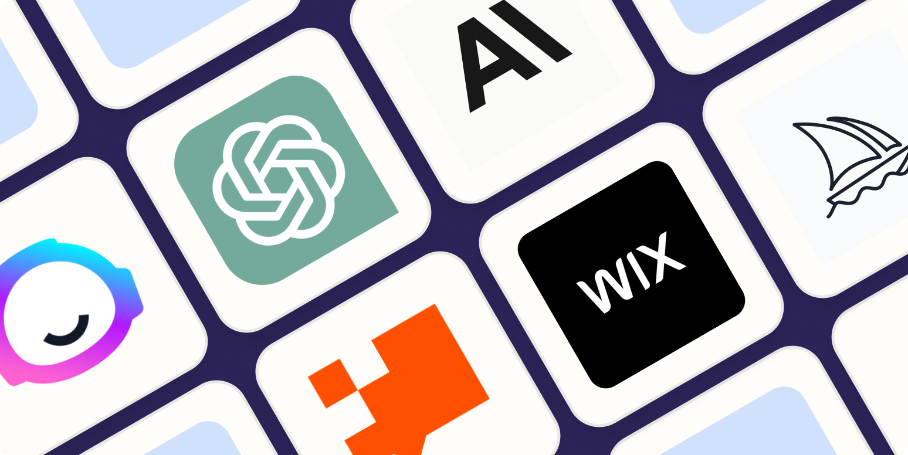

<small>[There is an AI for that](https://theresanaiforthat.com/)</small>

## Des combinaisons innombrables

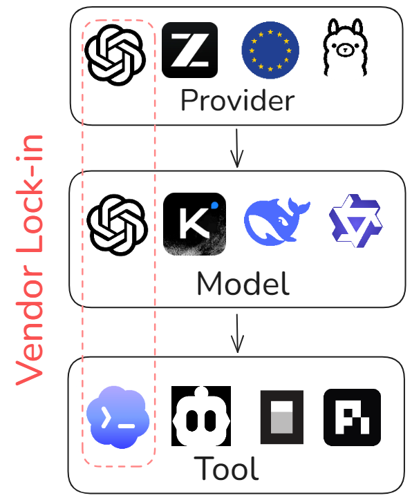

## Pourquoi surveiller ses données à l'ère de l'IA ?

::: {.fragment}
- Une bonne partie des données est vraiment sensible
:::

::: {.fragment}
- Aujourd'hui, elles risquent plus que jamais de fuiter par accident
<small>Contrat de confidentialité, Shadow AI, souvereignty washing</small>
:::

::: {.fragment}
- Les données sont le nouvel or
 
<small>Entraînement des IA</small>
:::

# Le piège de l'option par défaut

## Mars 2023, Samsung, Hwaseong {background-color="#3C444D"}

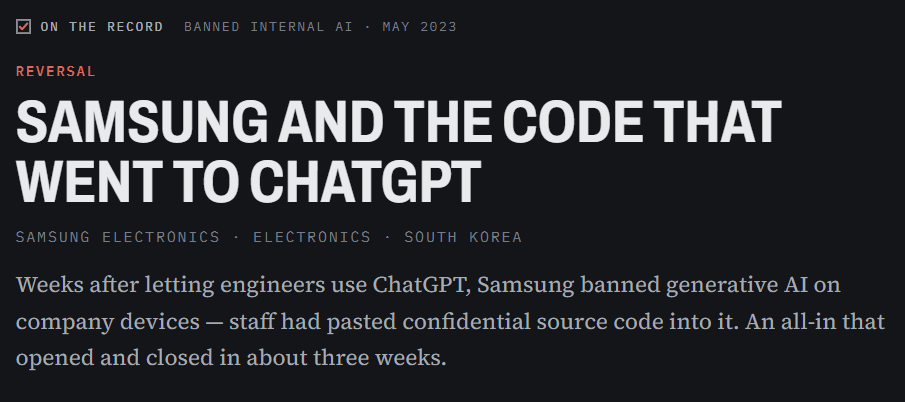

 

<small>[AI Incident Database, 2 mai 2023](https://incidentdatabase.ai/cite/768)</small> |
<small>[Bankrupt by AI, 30 mars 2023](https://www.bankruptbyai.com/case-files/samsung-code-leak)</small>

## Ils n'étaient pas négligents {background-color="#3C444D"}

::: {.fragment}
Ces ingénieurs utilisaient simplement le **réglage par défaut**.
:::

::: {.fragment}
> **Le choix leur avait été imposé.**
:::

<small>[You Pay $20/Month. ChatGPT Still Trains on You](https://lumichats.com/blog/chatgpt-claude-gemini-training-your-data-2026-privacy-guide)</small>

## Octobre 2025 : étude de Stanford {background-color="#3C444D"}

::: {.fragment}
> **6 entreprises sur 6** parmi les grands chatbots américains forment leurs modèles sur tes échanges par défaut
:::

::: {.fragment}
> Certaines conservent tes données **sans limite de temps**.
:::

::: {.fragment}
> La documentation sur la confidentialité est **souvent floue**.
:::

 

<small>[Stanford HAI, octobre 2025. Amazon, Anthropic, Google, Meta, Microsoft, OpenAI : environ 90 % du marché américain des chatbots](https://news.stanford.edu/stories/2025/10/ai-chatbot-privacy-concerns-risks-research)</small>

## ChatGPT de 2023 à aujourd'hui {background-color="#3C444D"}

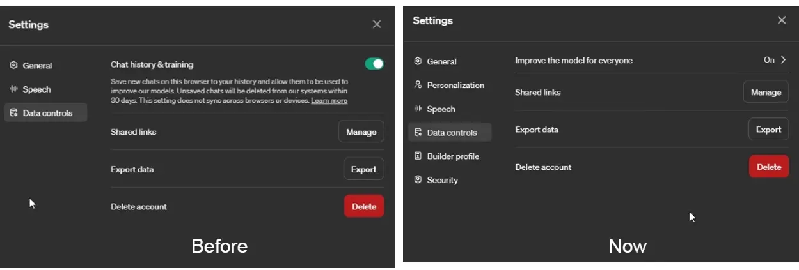

<small>[OpenAI Finally Relents; You Can Disable Model Training in ChatGPT While Retaining Chat History](https://beebom.com/chatgpt-disable-model-training-retain-chat-history/)</small>

## Deux catégories d'utilisateurs {background-color="#3C444D"}

**Utilisation des données pour l'entraînement**

:::: {.columns}

::: {.column width=50%}

**DÉSACTIVÉ** par défaut

- ChatGPT Business
- ChatGPT Enterprise
- ChatGPT Edu
- API Platform

:::

::: {.column width=50%}

**ACTIVÉ** par défaut

- ChatGPT Free
- ChatGPT Plus
- ChatGPT Pro

:::

:::

<small>[Centre d'aide OpenAI, "What if I want to disable model training?"](https://help.openai.com/en/articles/8983130-what-if-i-want-to-keep-my-history-on-but-disable-model-training)</small>

## Les débuts {background-color="#3C444D"}

:::: {.columns}
::: {.column width="70%"}
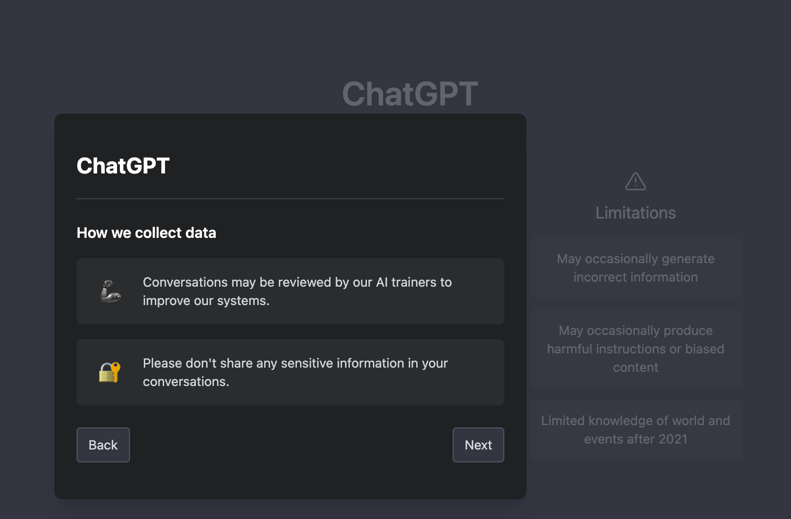
:::

::: {.column width="30%"}
::: {.fragment}
> Aujourd'hui, tout est noyé sous des pages entières de **documents juridiques**
:::

::: {.fragment}
> Pratique pour un **consentement silencieux**
:::
:::
::::
<small>[https://www.chino.io/post/chatgpt-privacy-risks](https://www.chino.io/post/chatgpt-privacy-risks)</small>

## X et LinkedIn {background-color="#3C444D"}

:::: {.columns}
::: {.column width=30%}
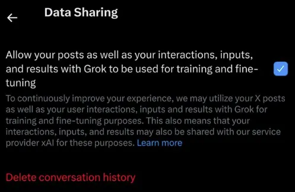
:::

::: {.column width=70%}
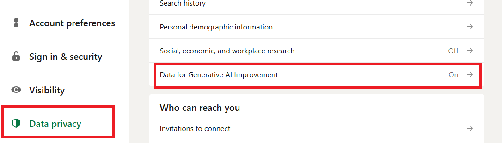
:::
:::
<small>[LinkedIn will use your data to train its AI unless you opt out now, septembre 2025](https://www.malwarebytes.com/blog/news/2025/09/linkedin-will-use-your-data-to-train-its-ai-unless-you-opt-out-now)</small> | <small>[X Adds New Setting To Opt out of Sharing Data To Train Grok](https://www.socialmediatoday.com/news/x-opt-out-of-sharing-your-data-to-train-grok/722601/)</small>

## Et alors ?

Le problème n'est pas l'entraînement sur les données...

::: {.fragment}
> Mais le **consentement silencieux**
:::

::: {.fragment}
> Et les **pratiques de conservation**
:::

# La souveraineté des données

## Qu'est-ce que la souveraineté des données ?

> C'est la capacité à contrôler **où vont tes données**, qui peut les consulter, et **quelles lois s'appliquent** quand tu utilises l'intelligence artificielle.

 

::: {.fragment}
**Souveraineté des données** \> **Souveraineté technologique**
:::

## Trois axes

1. **(Distance) À quelle distance tes données voyagent-elles physiquement ?**
2. **(Conservation) Que devient ta question une fois que le modèle l'a lue ?**
3. **(Juridiction) Quelles lois pourraient obliger à divulguer tes données ?**

## Axe 1 : la distance

**À quelle distance les données voyagent-elles physiquement ?**

::: {.fragment}
1. **Serveur étranger** : propriété d'une entreprise soumise à des lois qu'on n'a jamais votées
:::

::: {.fragment}
2. **Serveur européen** : géré par une entreprise qu'on a choisie
:::

::: {.fragment}
3. **Local** : On en est propriétaire
:::

## Axe 2 : la conservation {auto-animate="true"}

Que devient notre requête une fois que le modèle l'a lue ?

::: {.fragment}
1. **Profilage** : les entrées construisent un dossier lié à notre compte
:::

## Axe 2 : la conservation {auto-animate="true"}

Que devient notre requête une fois que le modèle l'a lue ?

1. **Profilage** : les entrées construisent un dossier longitudinal lié à notre compte

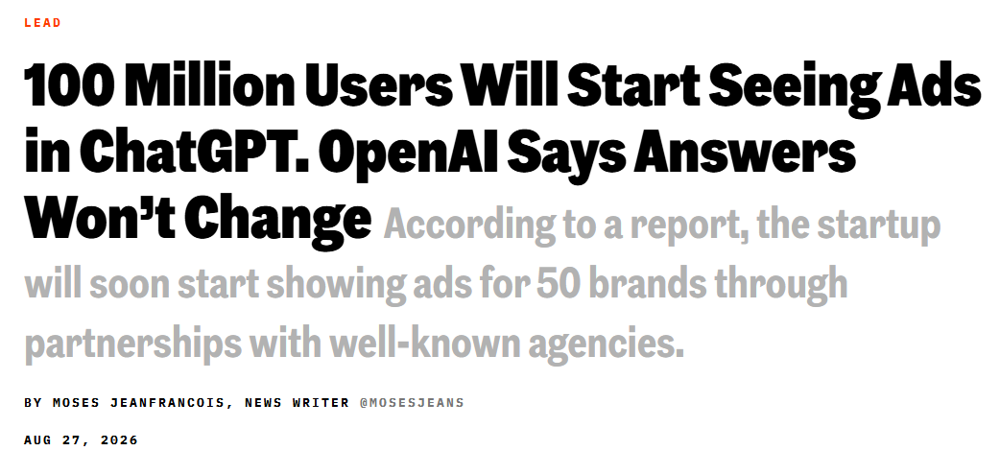

## Axe 2 : la conservation {auto-animate="true"}

Que devient notre requête une fois que le modèle l'a lue ?

1. **Profilage** : les entrées construisent un dossier lié à notre compte

2. **Entraînement** : ce ne sont plus nos données, elles font partie des poids de quelqu'un d'autre

::: {.fragment}
3. **Stockées mais inutilisées** : journalisées pour la surveillance des abus, susceptibles d'être demandées par des tiers
:::

::: {.fragment}
4. **Stockées et chiffrées** : seul l'utilisateur peut lire les données
:::

::: {.fragment}
5. **Conservation zéro** : les données ne servent que pour l'inférence, puis sont effacées ; l'historique reste en local
:::

::: {.fragment}
6. **Local** : aucune donnée ne quitte notre machine
:::

## L'affaire de priorité Navier-Stokes {background-color="#3C444D"}

::: {.fragment}
1. Deux mathématiciens, **Buckmaster** et **Alpöge**, ont passé un an sur une démonstration liée au prix du millénaire de Navier-Stokes.
:::

::: {.fragment}
2. Leurs brouillons de travail ont été intégrés dans l'outil **Codex** d'OpenAI.
:::

::: {.fragment}
3. Le *8 septembre 2026*, les agents d'OpenAI ont publié une revendication sur le même problème, **douze heures après** que l'un des mathématiciens ait publié son propre résultat.
:::

::: {.fragment}
> OpenAI a nié l'accès direct aux fichiers, mais a admis que son IA avait été entraînée dessus
:::

<small>[Navier-Stokes priority controversy Wikipedia](https://en.wikipedia.org/wiki/Navier%E2%80%93Stokes_priority_controversy)</small>

## Axe 3 : la juridiction (1)

**Quelles lois pourraient obliger à divulguer nos données ?**

::: {.fragment}
1. **Règles étrangères** : le Cloud Act américain ou la loi chinoise sur la cybersécurité
:::

::: {.fragment}
2. **Règles européennes** : le règlement général sur la protection des données (RGPD)
:::

::: {.fragment}
3. **Local** : nos propres règles ou celles de notre institution
:::

## Axe 3 : la juridiction (2)

**Le CLOUD Act, 2018 (États-Unis)** :

> un fournisseur américain doit remettre les données, **"qu'elles se trouvent à l'intérieur ou à l'extérieur des États-Unis".**

::: fragment
Ce qui compte, c'est **qui contrôle le fournisseur**, l'emplacement du serveur n'a aucune valeur légale.
:::

<small>[The CLOUD Act: A Plain-English Guide to Your Data & Government Access](https://uslawexplained.com/cloud_act)</small>

## Axe 3 : la juridiction (3)

**La loi sur la cybersécurité, 2017 (Chine)**

> les fournisseurs doivent coopérer avec les enquêtes de sécurité d'État, **fournir un support technique et des capacités de déchiffrement**, et stocker les "données importantes" **sur des serveurs situés en Chine**.

::: fragment
Ici, le lieu du serveur a de l'importance : il doit être **physiquement en Chine** pour la plupart des tâches d'IA.
:::

<small>[Cybersecurity Law of the People's Republic of China - wiki](https://en.wikipedia.org/wiki/Cybersecurity_Law_of_the_People%27s_Republic_of_China)</small>

## Axe 3 : la juridiction (4)

**Règlement général sur la protection des données (RGPD)**

> Exige que les données **restent dans l'EEE** (ou disposent de mécanismes de transfert spécifiques) et **limitent les transferts** vers des pays sans protection "adéquate".

::: fragment
Une entreprise peut être **100 % conforme au RGPD** (avec un DPA public, des politiques de conservation zéro, et du personnel européen) mais **rester soumise au CLOUD Act américain** si elle a une maison mère aux États-Unis
:::

## Trois axes, une carte {auto-animate="true"}

:::: {.columns}

::: {.column}
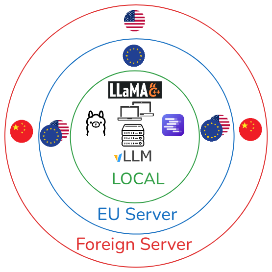
:::

::: {.column}
**Les trois axes se chevauchent**
:::
:::

## Trois axes, une carte {auto-animate="true"}

:::: {.columns}

::: {.column}
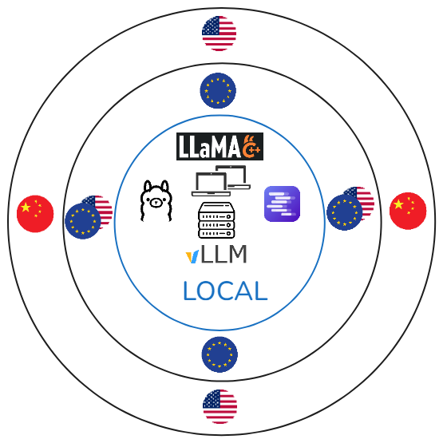
:::

::: {.column}
**Local**

- Aucun problème de **distance**
- Aucun problème de **conservation**
- Aucun problème de **juridiction**
:::
:::

## Trois axes, une carte {auto-animate="true"}

:::: {.columns}

::: {.column}

:::

::: {.column}
**Défense, secrets d'État, classifié**

Données sensibles, choses qui ne devraient jamais quitter ton ordinateur, ...
:::
::::

## Trois axes, une carte {auto-animate="true"}

:::: {.columns}

::: {.column}
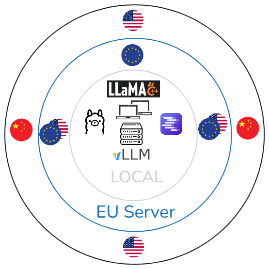
:::

::: {.column}
**Serveur européen**

- **Faible distance**
- La **conservation** devient importante
- Risque d'être confronté au **CLOUD Act**
:::
:::

## Trois axes, une carte {auto-animate="true" .scrollable} 

:::: {.columns}

::: {.column}

:::

::: {.column}
**Données personnelles (RGPD standard)**

Données clients, données employés, tout ce qui contient des noms

**Données réglementées**

Données de santé, secret bancaire, secret professionnel, enquêtes RH
<small>Conservation zéro</small>

**Propriété intellectuelle**

Code source, designs non publiés, l'affaire Samsung <small>chiffrement / conservation zéro</small>
:::
:::

## Trois axes, une carte {auto-animate="true" .scrollable} 

:::: {.columns}

::: {.column}
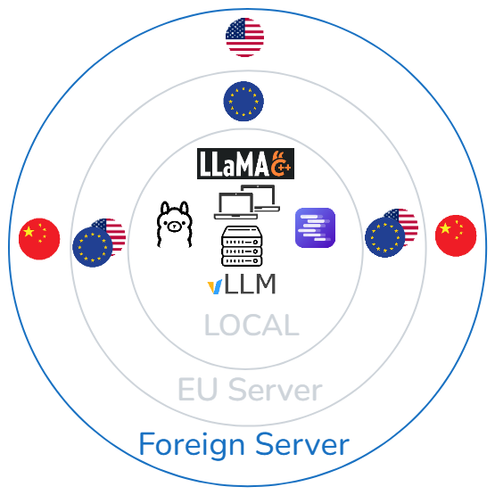
:::

::: {.column}
**Serveur étranger**

- **Grande distance**
- La **conservation** compte
- Soit le **CLOUD Act**, soit la **loi chinoise sur la cybersécurité** s'appliquent
:::
:::

## Trois axes, une carte {auto-animate="true" .scrollable} 

:::: {.columns}

::: {.column}

:::

::: {.column}
**Données déjà publiques.**

Brouillons de contenu marketing, documentation publiée, recherche générique, ...

**Internes, non personnelles, non secrètes**

Comptes rendus de réunion qui seront publiés de toute façon, communications internes sans importance critique.
:::
:::

# Modèles locaux et  open-weight

## Définitions

**Modèle open-weight**

> Modèle gratuit téléchargeable et utilisable, et modifiable par fine-tuning. (Llama, Qwen, Kimi, GLM, ...)

::: {.fragment}
**Open-weight** \> **Open-source** (+ données et étapes documentées)
:::

::: {.fragment}
**Modèle fermé**

> Propriété d'une entreprise, le modèle est non transparent. (GPT, Claude, Grok, ...)
:::

## Pourquoi "local" n'est plus un compromis

1. **Vraiment bon**
2. **Peu coûteux**
3. **Accessible**

## L'écart aujourd'hui (4 mois)

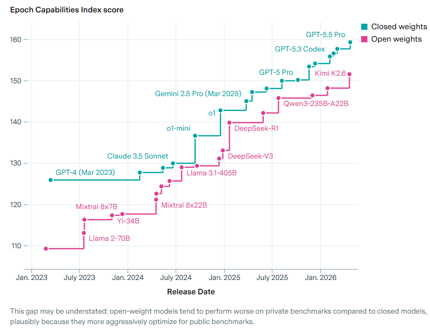

<small>[Epoch AI (mai 2026)](https://epoch.ai/data-insights/open-closed-eci-gap)</small>

## Ce que "quatre mois de retard" signifie vraiment

**Avant** : "Comme GPT-3 vs GPT-5" - des ères différentes

**Maintenant** : "Comme GPT-5 vs GPT-5.5" - la même ère, une version mineure

<small>[Epoch AI (mai 2026)](https://epoch.ai/data-insights/open-closed-eci-gap)</small>

## Peu coûteux (1)

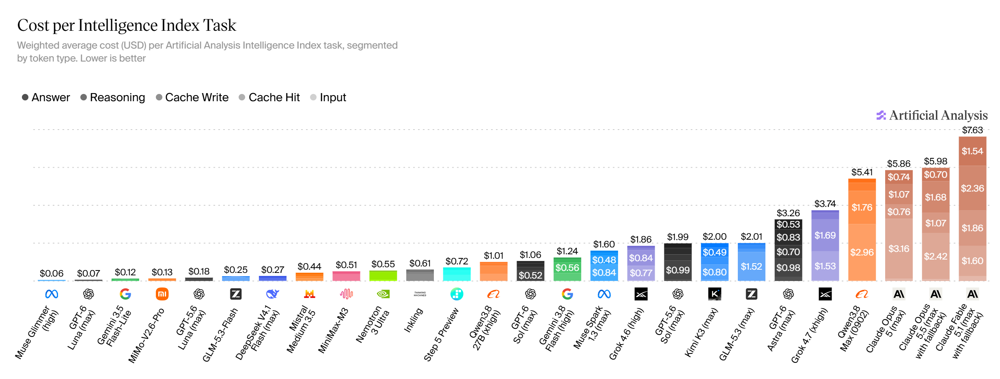

<small>[Independent analysis of AI - Artificial Analysis](https://artificialanalysis.ai/)</small>

## Peu coûteux (2)

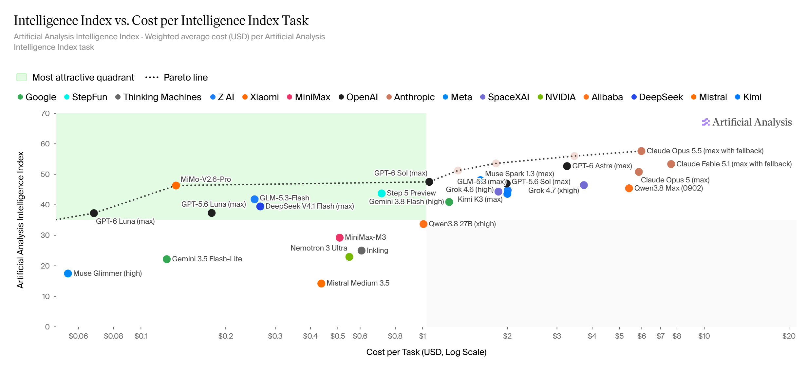

<small>[Independent analysis of AI - Artificial Analysis](https://artificialanalysis.ai/)</small>

## Jalons à mi-2026

**Kimi K3** - *Le plus grand modèle ouvert jamais créé*

**Qwen3.8-27B** - *Un seul GPU grand public*

**GLM5.3** - *Max : performances de pointe, Flash : rapide et vraiment bon marché*

## Limites

**1. Le moins cher par token \> le moins cher par tâche**

**2. Les benchmarks peuvent avantager les modèles ouverts (benchmark gaming)**

**3. L'utilisation d'outils agentiques reste un écart**

# Les options

## Panorama des services d'IA

::: {.fragment}
**1. Auto-hébergé** : contrôle absolu, ton matériel. Aucune donnée ne sort.
:::

::: {.fragment}
**2. Cloud européen complet** : propriétaires européens, stack européen.
:::

::: {.fragment}
**3. Neoclouds GPU** : calcul européen ou hybride, **on apporte nos propres modèles**. La juridiction varie.
:::

::: {.fragment}
**4. Routeurs et passerelles** : une enveloppe juridique européenne, plusieurs modèles en dessous.
:::

::: {.fragment}
**5. Hyperscaleurs masqués** : un masque européen sur une infrastructure américaine.
:::

## 1. Auto-hébergé {auto-animate="true"}

- Télécharge l'outil

- Télécharge le modèle

- Lance tout en local

<small>[Ollama](https://ollama.com)</small> |
<small>[LM Studio](https://lmstudio.ai/)</small> |
<small>[vLLM](https://docs.vllm.ai)</small> |
<small>[llama.cpp](https://github.com/ggml-org/llama.cpp)</small> |
<small>[SGLang](https://www.sglang.io/)</small>

## 1. Auto-hébergé {auto-animate="true"}

::: {.columns}

::: {.column}

**Avantages :**

  - Souveraineté absolue
  - Pas de "Vendor Lock-In"
  - Coûts prévisibles

:::

::: {.column}

**Inconvénients :**

  - Barrière matérielle
  - Barrière technique

:::

:::

<small>[Ollama](https://ollama.com)</small> |
<small>[LM Studio](https://lmstudio.ai/)</small> |
<small>[vLLM](https://docs.vllm.ai)</small> |
<small>[llama.cpp](https://github.com/ggml-org/llama.cpp)</small> |
<small>[SGLang](https://www.sglang.io/)</small>

## 1. Auto-hébergé {auto-animate="true"}

**Ressources pour démarrer avec les modèles locaux**

- [Local LLM Inference in 2026: The Complete Guide to Tools](blog.starmorph.com/blog/local-llm-inference-tools-guide)
- [A Beginner's Guide to Running AI Models Locally](itsthatlady.dev/blog/beginners-guide-to-local-ai)
- [Getting Started with Local AI: Run LLMs on Your Own Hardware](willitrunai.com/blog/getting-started-local-ai)
- [vLLM vs Ollama vs llama.cpp: Local Inference in 2026](https://whysogeek.com/vllm-ollama-llamacpp-which-inference-engine-2026/)
- [How to Run a Local AI Coding Agent](llmconfigurator.com/en/guides/coding-agents/setup-local-coding-agent)
- [Unsloth documentation](unsloth.ai/docs)

## 2. Cloud européen complet {auto-animate="true"}

Infrastructure de propriété européenne proposant des endpoints d'IA natifs, et certains permettent d'apporter notre propre modèle.

## 2. Cloud européen complet {auto-animate="true"}

::: {.columns}

::: {.column}

**Avantages :**

  - Sécurité juridictionnelle
  - Transparence de la stack technique
  - Conformité

:::

::: {.column}

**Inconvénients :**

  - Variété des modèles faible
  - Prix > Hypescaler étrangers
  - Petit écosystème

:::

:::

<small>[Infomaniak](https://www.infomaniak.com/en/hosting/ai-services)</small> |
<small>[OVHcloud](https://www.ovhcloud.com/en/public-cloud/ai-endpoints)</small> |
<small>[Scaleway](https://www.scaleway.com/en/generative-apis)</small> |
<small>[STACKIT](https://stackit.com/en/products/data-ai/stackit-ai-model-serving)</small> |
<small>[T Cloud Public](https://www.t-cloud-public.com/en/solutions/use-cases/artificial-intelligence/ai-foundation-services)</small> |
<small>[OUTSCALE](https://en.outscale.com)</small> |
<small>[Cloud Temple](https://www.cloud-temple.com/en/products/large-language-model-as-a-service-llmaas)</small> |
<small>[NumSpot](https://numspot.com/en)</small> |
<small>[IONOS](https://cloud.ionos.com/managed/ai-model-hub)</small> |
<small>[Exoscale](https://www.exoscale.com/ai-cloud-infrastructure/managed-inference)</small>

## 3. Neoclouds GPU {auto-animate="true"}

Fournisseurs de calcul spécialisés sur la puissance GPU brute, souvent en permettant d'apporter notre propre modèle (BYOM).

<small>[Verda](https://verda.com)</small> |
<small>[Nebius](https://tokenfactory.nebius.com)</small> |
<small>[Nscale](https://www.nscale.com)</small> |
<small>[CloudFerro](https://cloudferro.com)</small> |
<small>[Berget AI](https://berget.ai/en)</small> <small>(juridiction britannique)</small>

## 3. Neoclouds GPU {auto-animate="true"}

::: {.columns}

::: {.column}

**Avantages :**

- Bon rapport qualité-prix (moins cher)
- Flexibilité (choix)
- Scalabilité

:::

::: {.column}

**Inconvénients :**

- Risque juridictionnel (Cloud Act)
- Besoin de gestion

:::
:::

<small>[Verda](https://verda.com)</small> |
<small>[Nebius](https://tokenfactory.nebius.com)</small> |
<small>[Nscale](https://www.nscale.com)</small> |
<small>[CloudFerro](https://cloudferro.com)</small> |
<small>[Berget AI](https://berget.ai/en)</small> <small>(juridiction britannique)</small>

## 4. Routeurs et passerelles {auto-animate="true"}

Services qui s'intercalent entre l'utilisateur et plusieurs fournisseurs en arrière-plan, en routant les requêtes selon nos règles (généralement).

<small>[cortecs](https://cortecs.ai)</small> |
<small>[TextCortex](https://textcortex.com/eu-ai-models/openrouter-alternative-europe)</small> |
<small>[Requesty](https://www.requesty.ai/eu)</small>

## 4. Routeurs et passerelles {auto-animate="true"}

::: {.columns}

::: {.column}

**Avantages :**

- Interface unifiée (API unique)
- Optimisation (routeur dynamique)

:::

::: {.column}

**Inconvénients :**

- Risque de sovereignty washing
- Confiance, toujours vérifier

:::

:::

<small>[cortecs](https://cortecs.ai)</small> |
<small>[TextCortex](https://textcortex.com/eu-ai-models/openrouter-alternative-europe)</small> |
<small>[Requesty](https://www.requesty.ai/eu)</small>

## 5. Hyperscaleurs {auto-animate="true"}

<small>[S3NS](https://s3ns.io)</small> |
<small>[Bleu](https://www.bleucloud.fr)</small> |
<small>[AWS European Sovereign Cloud](https://www.aws.eu)</small> |
<small>[Azure EU Data Boundary](https://www.microsoft.com/en-us/trust-center/privacy/european-data-boundary-eudb)</small>

## 5. Hyperscaleurs {auto-animate="true"}

::: {.columns}

::: {.column}

**Avantages :**

  - Performances (pointe)
  - Écosystème (bonne intégration)
  - Échelle

:::

::: {.column}

**Inconvénients :**

  - Peu de contrôle (États-Unis, Chine)
  - Dépendance

:::
:::

<small>[S3NS](https://s3ns.io)</small> |
<small>[Bleu](https://www.bleucloud.fr)</small> |
<small>[AWS European Sovereign Cloud](https://www.aws.eu)</small> |
<small>[Azure EU Data Boundary](https://www.microsoft.com/en-us/trust-center/privacy/european-data-boundary-eudb)</small>

## Résumé {.scrollable}

| Catégorie | Options | Distance (flux de données) | Conservation (ce qu'ils gardent) | Juridiction (bouclier légal) |
| :--- | :--- | :--- | :--- | :--- | :--- |
| **1. Auto-hébergé** | Ollama, LM Studio, vLLM, llama.cpp, SGLang | **Local** (ta machine) | **Zéro** (sauf si tu actives l'historique / les journaux) | **Ta juridiction** (contrôle physique) |
| **2. Cloud EU complet** | OVHcloud, Scaleway, STACKIT, T Cloud Public, OUTSCALE, Cloud Temple, NumSpot, IONOS, Exoscale, Infomaniak | **UE** (les données restent dans des centres en UE) | **Configurable** (la plupart proposent "conservation zéro" ou des options strictes "pas d'entraînement" ; vérifier le SLA spécifique) | **UE** (protégé du Cloud Act ; géré par des tribunaux européens) |
| **3. Néoclouds GPU** | Verda, Nebius, Nscale, CloudFerro, Berget AI | **UE / Royaume-Uni** (varie selon la région choisie) | **Variable** (souvent conservation zéro pour l'inférence ; vérifier les politiques d'entraînement) | **Mixte** (Nebius / Verda / CloudFerro : UE ; **Berget AI : Royaume-Uni**) |
| **4. Routeurs & passerelles** | cortecs, TextCortex, Requesty | **UE** (couche de routage en UE) | **Configurable** (modes de conservation zéro disponibles) | **UE** (natif RGPD, mais *dépend du fournisseur en amont*) |
| **5. Hyperscaleurs masqués** | S3NS, Bleu, AWS EC, Azure EUD | **UE** (données physiquement en UE) | **Variable** (souvent conservées pour l'amélioration des modèles sauf désabonnement) | **États-Unis / mondial** (maison mère soumise au Cloud Act) |

## L'essentiel à retenir

 

::: {.fragment}
> N'utilisons **pas seulement** l'**option par défaut**.
:::

::: {.fragment}
> Utilisons ce qui nous convient **le mieux**.
:::
 

# Merci de votre attention
